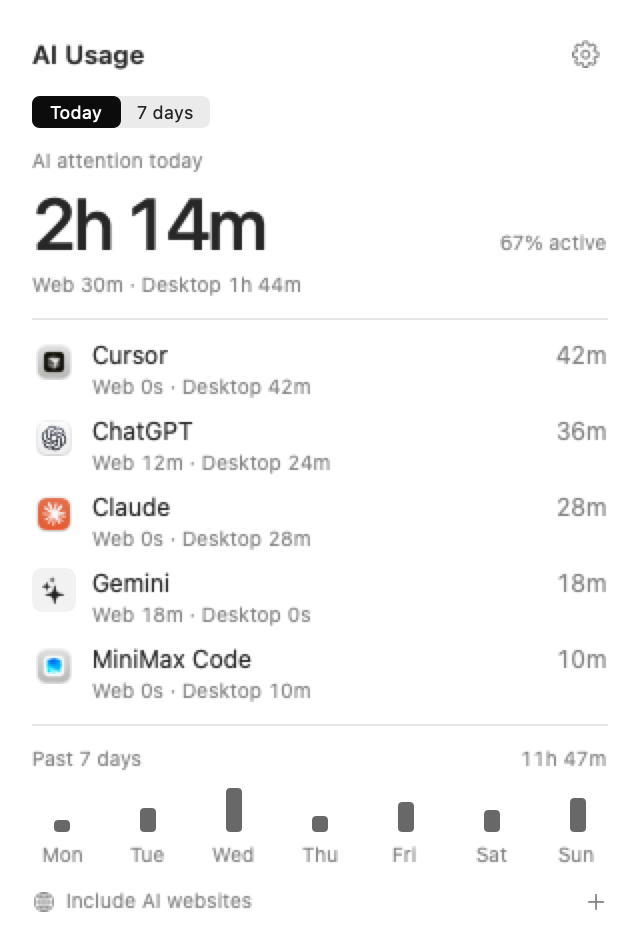
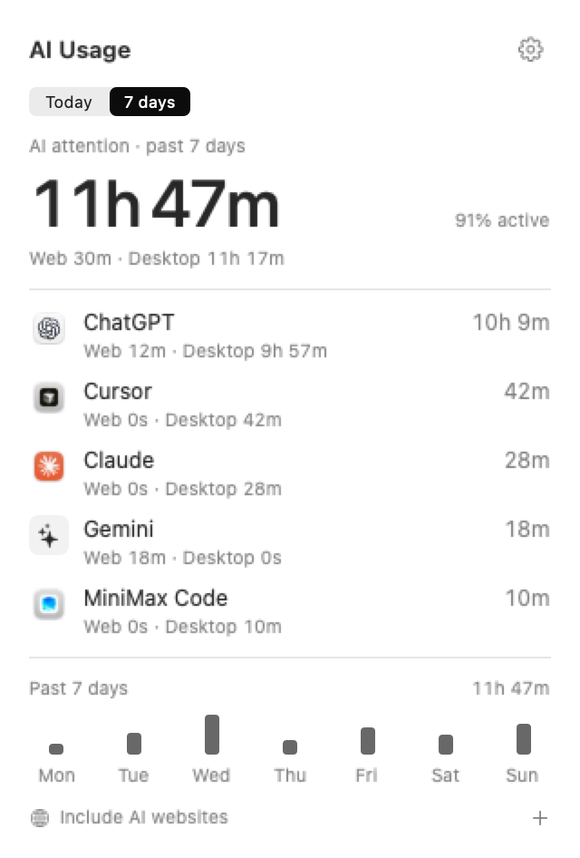
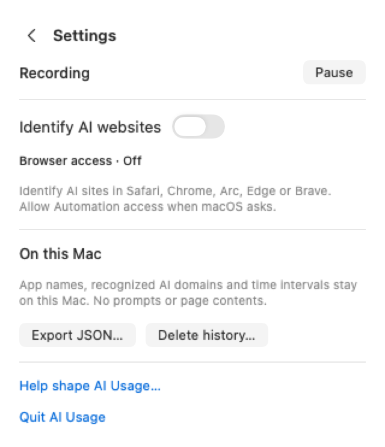

# AI Usage

**A little clarity for your AI day.** A small, native Mac menu-bar app that brings your AI attention together—across desktop apps and websites.

[Download for macOS (.dmg)](https://github.com/krumjahn/ai-usage/releases/download/v0.1.2-preview/AI-Usage-0.1.2-preview.dmg) · [Release notes](https://github.com/krumjahn/ai-usage/releases/tag/v0.1.2-preview) · [Suggest an idea](https://github.com/krumjahn/ai-usage/issues/new/choose)

<picture>
  <source media="(prefers-color-scheme: dark)" srcset="docs/images/dashboard-dark.png">
  
</picture>

*Actual app, illustrative data. Public screenshots never use a person's activity history.*

## Screenshots and video

**Which AI gets your time?** Press Play: zoom into a MacBook’s menu bar, click the timer, and see your desktop and web attention together.

https://github.com/user-attachments/assets/b2db6336-5f23-40a7-8258-9f99b48c04ae

[Download the demo MP4](https://github.com/krumjahn/ai-usage/releases/download/v0.1.0-preview/ai-usage-laptop-demo.mp4) · [All screenshots](docs/images) · [Mac preview release](https://github.com/krumjahn/ai-usage/releases/tag/v0.1.0-preview)

<details>
<summary>Seven-day view and Settings</summary>

<p>
  
  
</p>

</details>

The screenshots and eight-second landscape demo show the real native interface with synthetic records. The demo uses a 3D MacBook, a staged desktop, and subtle sound effects; sample data is labeled throughout. [Video and asset credits](docs/media/README.md). The earlier 14-second demo and its editable source in `promo/` are preserved.

## What it does

- Today's AI attention in the menu bar, refreshed every 10 seconds.
- One total per tool, with a small **Web / Desktop** split underneath.
- Today and past-seven-days views in a compact, 320pt native panel.
- ChatGPT, Claude, Codex, Cursor, Gemini, Grok, Windsurf, MiniMax Code and more. See the [registry](Core/AIToolClassifier.swift) for precise supported surfaces.
- Opt-in website identification in Safari, Chrome, Arc, Edge and Brave. Generic browser time is not AI time.
- Local SQLite history. Pause, export JSON, or delete history from Settings.
- Light and dark appearance. No account required.

This measures **active foreground attention**, not tokens, subscription allowances, background agents or productivity. Terminal time alone cannot identify Claude Code or another agent. It counts one foreground interval at a time, excludes idle and sleep gaps, and does not combine devices. The total updates as input confirms saved observations; it is not an independent stopwatch.

## Try it

macOS 13 or later. The [v0.1.2 preview](https://github.com/krumjahn/ai-usage/releases/tag/v0.1.2-preview) is an **ad-hoc signed, unnotarized developer preview**, not a Developer ID release. macOS may block downloaded builds. Download the universal DMG, drag **AI Usage.app** to **Applications**, eject the disk image, and open the app. See [installation notes](docs/INSTALL.md) for macOS approval steps or building from source.

Launch the app and look for a time such as `0s` or `42m` in the macOS menu bar. Click it to open the dashboard. If the menu bar is crowded, close another menu-bar utility temporarily. Opening AI Usage again also opens its dashboard window.

For browser time, enable **Settings → Identify AI websites**, then bring a supported browser with a recognized AI site to the foreground. Allow the macOS Automation request for that browser. Other background tabs do not count.

## Build and test

Requires Xcode and its command-line tools, plus [XcodeGen](https://github.com/yonaskolb/XcodeGen). The internal scheme/executable remains `AttentionLedger`; the app is called AI Usage. The single macOS app and its XCTest bundle target macOS 13. Local builds use ad-hoc signing; no developer account is required.

```sh
brew install xcodegen
xcodegen generate
xcodebuild -scheme AttentionLedger -destination 'platform=macOS' -derivedDataPath build -parallel-testing-enabled NO test
xcodebuild -scheme AttentionLedger -configuration Release -destination 'platform=macOS' -derivedDataPath build build
open build/Build/Products/Release/AttentionLedger.app --args --dashboard
```

Quit any running AI Usage instance before launching a second build. Two collectors must not write the same production database concurrently. Tests use temporary databases and never start the production collector.

## Privacy & feedback

Activity stays at `~/Library/Application Support/com.rumjahn.attentionledger/activity.sqlite`. The bundle ID and support directory are stable so upgrades preserve history. No prompts, source code, window titles, full URLs, page contents or unrecognized website domains are saved.

The optional three-question feedback sheet sends only explicitly submitted answers and app version, plus a random submission ID and form version. It never sends activity history. **Starting with v0.1.2-preview, a welcome questionnaire opens automatically on first launch—even if you never click the menu bar.** Choose **Skip and start** to go straight to the dashboard without sending anything, or **Send and start** to submit your answers. Existing users also see this new welcome once after updating; subsequent launches stay in the menu bar. You can reopen it in Settings → Help shape AI Usage. Submitted responses are privately stored in Cloudflare D1 and removed by a daily 90-day retention job. [Welcome screen](docs/images/onboarding.png) · [Privacy details](website/public/privacy.html) · [Deployment instructions](docs/DEPLOYMENT.md).

## Inside the repository

| Directory | Purpose |
| --- | --- |
| `Core/` | Collector, browser adapters, normalization, versioned classification, SQLite storage, analytics |
| `App/` | Native dashboard, menu-bar presentation, local settings, optional feedback |
| `Tests/` | Collection, classification, storage, analytics, navigation, feedback and privacy tests |
| `website/` | Deferred website draft + live, optional Cloudflare feedback service |
| `promo/` | Editable 14-second HyperFrames product demo |
| `Design/`, `scripts/` | Original icon and reproducible screenshots using synthetic records |

Feedback API: `cd website && npm ci && npm run dev`. Preview the deferred website separately with `python3 -m http.server 8080 --directory website/public`. Backend tests: `npm test && npm run types && npm run check`. Deployment and private feedback export are documented in [DEPLOYMENT.md](docs/DEPLOYMENT.md). No analytics scripts or third-party fonts.

**The launch is GitHub-first.** The website is not published, and its deployment workflow is disabled with no automatic push trigger. Its source is kept for later. Screenshots and the demo are available directly above and in the release. Only the optional feedback API is deployed; its root serves no website. No credentials belong in source control.

## Contribute

Bug reports, tool-registry improvements and small pull requests are welcome. See [CONTRIBUTING.md](CONTRIBUTING.md), [security reporting](SECURITY.md) and [validation](VALIDATION.md). Please never attach usage exports or credentials to public issues.

MIT licensed. Adapted from Keith Rumjahn's Brainrot Swift collection pipeline; this app runs independently. Product names and icons belong to their respective owners; their appearance does not imply endorsement.
