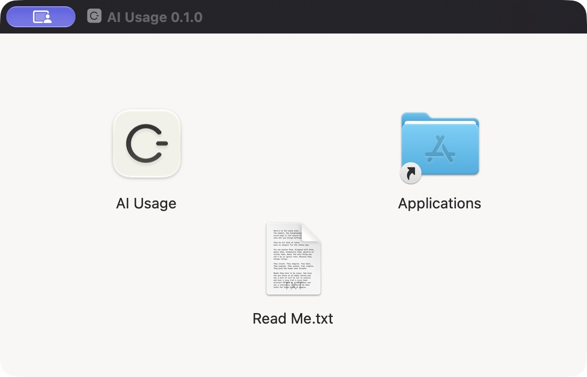

# Install the preview

AI Usage supports macOS 13+. The release archive states its supported processor architectures. The app is a menu-bar utility; it does not need to stay in the Dock.

## Download the DMG



1. Download [AI-Usage-0.1.0-preview.dmg](https://github.com/krumjahn/ai-usage/releases/download/v0.1.0-preview/AI-Usage-0.1.0-preview.dmg) from the [GitHub release](https://github.com/krumjahn/ai-usage/releases/tag/v0.1.0-preview). The same DMG supports Apple Silicon and Intel.
2. Open the DMG and drag **AI Usage.app** onto **Applications**. Quit any running AI Usage instance before replacing it.
3. Eject the disk image, then open **AI Usage** from Applications.
4. This preview is ad-hoc signed, **not Developer ID signed or notarized**. macOS may block it. If you trust this project and want to proceed, follow [Apple's per-app approval instructions](https://support.apple.com/en-us/102445): after trying to open it, go to **System Settings → Privacy & Security → Open Anyway** and confirm the app. Do not disable Gatekeeper system-wide. You can also build from source below.

For integrity verification, download `SHA256SUMS.txt` from the same release and compare:

```sh
shasum -a 256 AI-Usage-0.1.0-preview.dmg
```

The ZIP remains available as an alternative: download `AI-Usage-0.1.0-preview.zip`, check its checksum, unzip, then move the app to Applications. Both packages contain the same app, with no personal activity history or credentials.

## Source build

Use the build commands in the README. XcodeGen generates the project, Xcode builds it with an ad-hoc signature. There are no third-party Swift packages. Quit the previous instance before launching a different build. Copy your built app to Applications if desired.

Click the time in the menu bar to see the dashboard. Open the app again to show a window if its menu item is hidden by a crowded menu bar or a notch.

## Website identification

In the gear menu, enable **Identify AI websites**. Focus a recognized AI site in Safari, Chrome, Arc, Edge or Brave and grant Automation access when macOS asks. Permissions are managed in System Settings → Privacy & Security → Automation. App foreground tracking does not require Accessibility, Screen Recording or Input Monitoring permission.

It only records the foreground app and recognized site. Having an AI app or tab open in the background does not count. Idle time, sleeping, and time in unrecognized websites do not add AI minutes.

## Upgrades and removal

Keep bundle identifier `com.rumjahn.attentionledger` and its application support directory to preserve existing history. Quit before replacing a build. Removing the app bundle does not remove your local activity database. Use Settings → Export JSON for a copy, or Delete history for explicit removal. Device backups and exported copies are separate.

The optional feedback questionnaire is inactive in v0.1.0-preview until a service endpoint is configured. No provider credentials or subscription connections are used.
